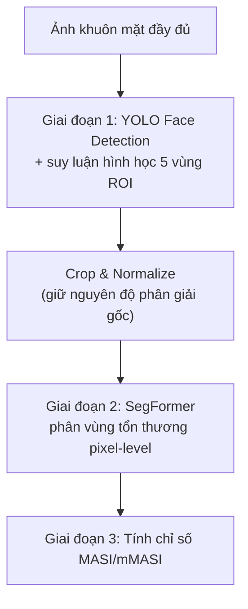

**[TÊN TRƯỜNG ĐẠI HỌC]**
**[TÊN KHOA]**

---

# KHÓA LUẬN TỐT NGHIỆP

# XÂY DỰNG NỀN TẢNG DERMACARE AI VÀ ĐỀ XUẤT KIẾN TRÚC THỊ GIÁC MÁY TÍNH HỖ TRỢ ĐÁNH GIÁ ĐỊNH LƯỢNG BỆNH NÁM DA

 

**Ngành:** [Công nghệ Thông tin / Trí tuệ Nhân tạo]
**Sinh viên thực hiện:** [Họ và tên]
**Mã số sinh viên:** [MSSV]
**Giảng viên hướng dẫn:** [Họ và tên GVHD]

 

**[Thành phố], [Năm học]**

## LỜI CAM ĐOAN

Tôi xin cam đoan đây là công trình nghiên cứu của riêng tôi, được thực hiện dưới sự
hướng dẫn của [Họ và tên GVHD]. Các số liệu, kết quả thực nghiệm trình bày trong khóa
luận là trung thực, do chính tôi thực hiện thu thập và xử lý, chưa từng được công bố
trong bất kỳ công trình nào khác. Các thông tin trích dẫn, tham khảo từ các công trình
nghiên cứu, tài liệu khoa học đã công bố của các tác giả khác đều được ghi rõ nguồn
gốc đầy đủ trong danh mục tài liệu tham khảo.

Tôi xin chịu hoàn toàn trách nhiệm về lời cam đoan này.

[Thành phố], ngày ... tháng ... năm ...
**Sinh viên thực hiện**

   

**[Họ và tên]**

## LỜI CẢM ƠN

Tôi xin bày tỏ lòng biết ơn sâu sắc đến [Họ và tên GVHD] — người đã tận tình hướng
dẫn, định hướng và góp ý trong suốt quá trình tôi thực hiện khóa luận này.

Tôi xin chân thành cảm ơn quý Thầy/Cô trong [Khoa/Bộ môn], [Tên trường] đã truyền đạt
kiến thức nền tảng quý báu trong suốt quá trình học tập, là cơ sở để tôi có thể hoàn
thành khóa luận tốt nghiệp này.

Tôi cũng xin gửi lời cảm ơn đến gia đình, bạn bè đã luôn động viên, hỗ trợ tôi trong
suốt quá trình thực hiện đề tài.

Do thời gian và kiến thức còn hạn chế, khóa luận không tránh khỏi những thiếu sót. Tôi
rất mong nhận được sự góp ý của quý Thầy/Cô để hoàn thiện hơn.

Tôi xin chân thành cảm ơn.

**[Họ và tên sinh viên]**

## TÓM TẮT

Nám da (Melasma) là bệnh lý tăng sắc tố da mắc phải phổ biến, ảnh hưởng đáng kể đến
tâm lý và thẩm mỹ người mắc. Khóa luận này trình bày hai nội dung liên kết: (1) mô tả
nền tảng DermaCare AI v1.0 — hệ thống giáo dục và tự đánh giá sức khỏe da liễu vận
hành cục bộ, ưu tiên bảo mật dữ liệu người dùng; và (2) thiết kế, triển khai, đánh giá
thực nghiệm một kiến trúc thị giác máy tính hai giai đoạn (Coarse-to-Fine Pipeline) —
kết hợp YOLO định vị vùng giải phẫu và SegFormer phân vùng ngữ nghĩa pixel-level —
nhằm định lượng diện tích, mức độ tổn thương Nám da và tính toán tự động chỉ số MASI.

Trước hạn chế về dữ liệu Nám da chuyên biệt công khai, khóa luận áp dụng chiến lược
huấn luyện trên bộ dữ liệu thay thế ISIC 2018 (Lesion Boundary Segmentation), đạt kết
quả Dice Score 0,903 và IoU 0,838 trên 554 ảnh kiểm định. Giai đoạn định vị vùng giải
phẫu đạt mIoU 0,248 trên tập kiểm định 21 ảnh Nám thật tự gán nhãn. Pipeline hoàn
chỉnh được minh chứng vận hành thành công từ ảnh đầu vào đến kết quả tính toán chỉ số
MASI/mMASI. Khóa luận trình bày trung thực các hạn chế về khoảng cách miền dữ liệu, cỡ
mẫu đánh giá, và đề xuất các hướng phát triển tiếp theo.

**Từ khóa:** Nám da, Melasma, YOLO, SegFormer, phân vùng ngữ nghĩa, chỉ số MASI, thị
giác máy tính, học sâu.

## ABSTRACT

Melasma is a common acquired hypermelanosis that significantly affects patients'
psychological well-being and aesthetic concerns. This thesis presents two connected
contributions: (1) a description of the DermaCare AI v1.0 platform — a locally-hosted
dermatology education and self-assessment system prioritizing user data privacy; and
(2) the design, implementation, and experimental evaluation of a two-stage computer
vision pipeline (Coarse-to-Fine architecture) — combining YOLO-based anatomical region
detection with SegFormer-based pixel-level semantic segmentation — to quantify melasma
lesion area, severity, and automatically compute the MASI index.

Given the lack of publicly available, pixel-level annotated melasma-specific datasets,
this thesis adopts a proxy-dataset training strategy using ISIC 2018 (Lesion Boundary
Segmentation), achieving a Dice Score of 0.903 and an IoU of 0.838 on 554 validation
images. The anatomical region localization stage achieved an mIoU of 0.248 on a
manually annotated set of 21 real melasma images. The complete pipeline was
successfully demonstrated end-to-end, from input image to MASI/mMASI score
computation. The thesis transparently discusses limitations regarding domain gap and
evaluation sample size, and proposes concrete directions for future work.

**Keywords:** Melasma, YOLO, SegFormer, semantic segmentation, MASI index, computer
vision, deep learning.

## MỤC LỤC

- **CHƯƠNG 1: MỞ ĐẦU**
  - 1.1. Đặt vấn đề
  - 1.2. Mục tiêu đề tài
  - 1.3. Đối tượng và phạm vi nghiên cứu
  - 1.4. Giới hạn y khoa của hệ thống
  - 1.5. Ý nghĩa đề tài
- **CHƯƠNG 2: TỔNG QUAN TÀI LIỆU**
  - 2.1. Tổng quan về bệnh Nám da (Melasma)
  - 2.2. Các yếu tố nguy cơ của bệnh Nám da — kết quả từ nghiên cứu dữ liệu cộng đồng
  - 2.3. Tổng quan các phương pháp trí tuệ nhân tạo liên quan
  - 2.4. Khoảng trống nghiên cứu
- **CHƯƠNG 3: KIẾN TRÚC HỆ THỐNG DERMACARE AI V1.0**
  - 3.1. Tổng quan nền tảng
  - 3.2. Các module chức năng
  - 3.3. Kiến trúc AI hiện tại của nền tảng
  - 3.4. Kiến trúc bảo mật
  - 3.5. Hạn chế hiện tại và tiền đề cho hướng phát triển
- **CHƯƠNG 4: PHƯƠNG PHÁP NGHIÊN CỨU — ĐỀ XUẤT VÀ TRIỂN KHAI LÕI AI (HƯỚNG 1)**
  - 4.1. Đặt vấn đề: Bài toán đánh đổi độ phân giải (Resolution Tradeoff)
  - 4.2. Kiến trúc Coarse-to-Fine hai giai đoạn
  - 4.3. Hàm lượng khoa học và phân tích ưu điểm
  - 4.4. Giai đoạn 3 — Tích hợp tính toán chỉ số MASI
  - 4.5. Thảo luận về tính khả thi và giới hạn của đề xuất
- **CHƯƠNG 5: KẾT LUẬN VÀ HƯỚNG PHÁT TRIỂN**
  - 5.1. Kết quả đạt được
  - 5.2. Hạn chế của khóa luận
  - 5.3. Hướng phát triển
  - 5.4. Kết luận chung
- **TÀI LIỆU THAM KHẢO**

## DANH MỤC HÌNH ẢNH

| STT | Tên hình | Trang |
|---|---|---|
| Hình 4.1 | Sơ đồ kiến trúc pipeline Coarse-to-Fine ba giai đoạn | ... |
| Hình 4.2 | Biểu đồ Learning Curve huấn luyện SegFormer (Log Loss theo epoch) | ... |
| Hình 4.3 | Ảnh minh hoạ kết quả phân vùng chồng lên ảnh gốc (full overlay) | ... |

## DANH MỤC BẢNG BIỂU

| STT | Tên bảng | Trang |
|---|---|---|
| Bảng 3.1 | Cấu trúc mã nguồn cốt lõi của nền tảng DermaCare AI v1.0 | ... |
| Bảng 4.1 | Kết quả IoU của Giai đoạn 1 theo từng vùng giải phẫu | ... |
| Bảng 4.2 | Kết quả đánh giá định lượng Giai đoạn 2 trên tập ISIC 2018 | ... |
| Bảng 4.3 | Kết quả tính toán MASI/mMASI trên ảnh demo thực tế | ... |
| Bảng 5.1 | Tổng hợp kết quả thực nghiệm đạt được | ... |

## DANH MỤC TỪ VIẾT TẮT

| Từ viết tắt | Ý nghĩa đầy đủ |
|---|---|
| AI | Artificial Intelligence (Trí tuệ nhân tạo) |
| AES-GCM | Advanced Encryption Standard – Galois/Counter Mode |
| CC-0 / CC-BY / CC-BY-NC-SA | Các loại giấy phép Creative Commons |
| Dice | Dice Similarity Coefficient (Hệ số tương đồng Dice) |
| IoU | Intersection over Union |
| ISIC | International Skin Imaging Collaboration |
| MASI | Melasma Area and Severity Index |
| mMASI | modified Melasma Area and Severity Index |
| PBKDF2 | Password-Based Key Derivation Function 2 |
| ROI | Region of Interest (Vùng quan tâm) |
| VRAM | Video Random Access Memory |
| YOLO | You Only Look Once |

# CHƯƠNG 1: MỞ ĐẦU

## 1.1. Đặt vấn đề

Nám da (Melasma) là một trong những bệnh lý tăng sắc tố da mắc phải phổ biến nhất,
đặc trưng bởi các mảng dát sẫm màu, đối xứng, thường xuất hiện ở các vùng da tiếp xúc
nhiều với ánh nắng như má, trán, mũi, cằm và môi trên. Mặc dù là bệnh lý lành tính về
mặt y khoa, Nám da ảnh hưởng đáng kể đến tâm lý và thẩm mỹ của người mắc, đặc biệt phổ
biến ở phụ nữ và có liên quan chặt chẽ đến các yếu tố nội tiết, di truyền, thói quen
sinh hoạt và mức độ phơi nắng.

Trong bối cảnh nhu cầu chăm sóc và theo dõi sức khỏe làn da ngày càng tăng, cùng với
sự phát triển mạnh mẽ của trí tuệ nhân tạo (AI) trong lĩnh vực y tế, việc xây dựng các
nền tảng hỗ trợ giáo dục sức khỏe da liễu — giúp người dùng tự tìm hiểu, nhận biết sớm
các dấu hiệu bất thường và có định hướng tham vấn y tế phù hợp — trở thành một hướng
đi có giá trị thực tiễn cao. Tuy nhiên, phần lớn các công cụ hiện có trên thị trường
hoặc chỉ dừng ở mức cung cấp thông tin tĩnh, hoặc yêu cầu kết nối máy chủ đám mây liên
tục (đặt ra lo ngại về quyền riêng tư dữ liệu sức khỏe cá nhân), hoặc thiếu khả năng
đánh giá định lượng trực quan dựa trên hình ảnh thực tế của người dùng.

Xuất phát từ thực tế đó, khóa luận này tập trung vào hai mục tiêu liên kết chặt chẽ:
(1) giới thiệu nền tảng **DermaCare AI v1.0** — một hệ thống giáo dục và tự đánh giá
sức khỏe da liễu vận hành hoàn toàn cục bộ (offline-first), ưu tiên bảo mật dữ liệu
người dùng; và (2) đề xuất, thiết kế và triển khai thử nghiệm một **kiến trúc thị giác
máy tính** (pipeline "Hướng 1") có khả năng mở rộng nền tảng này sang hướng phân tích
định lượng vết Nám từ ảnh chụp khuôn mặt, làm cơ sở khoa học cho các phát triển tiếp
theo của sản phẩm.

## 1.2. Mục tiêu đề tài

Khóa luận hướng tới các mục tiêu cụ thể sau:

1. Trình bày tổng quan các đặc điểm y khoa, nguyên nhân và yếu tố nguy cơ của bệnh Nám
   da, dựa trên các nghiên cứu và tài liệu khoa học đã công bố.
2. Mô tả và phân tích kiến trúc hệ thống thực tế của nền tảng DermaCare AI v1.0 —
   một sản phẩm giáo dục sức khỏe da liễu đã được xây dựng, vận hành cục bộ, có các
   module tra cứu kiến thức, đánh giá loại da theo thang Fitzpatrick, và khảo sát chăm
   sóc da cá nhân hoá.
3. Thiết kế và triển khai thử nghiệm một kiến trúc thị giác máy tính hai giai đoạn
   (Coarse-to-Fine Pipeline), kết hợp phát hiện vùng giải phẫu (YOLO) và phân vùng
   ngữ nghĩa pixel-level (SegFormer), nhằm định lượng diện tích và mức độ tổn thương
   Nám từ ảnh khuôn mặt.
4. Đánh giá định lượng, trung thực các kết quả thực nghiệm đạt được của kiến trúc đề
   xuất, đồng thời phân tích rõ các hạn chế và đề xuất hướng phát triển tiếp theo.

## 1.3. Đối tượng và phạm vi nghiên cứu

**Đối tượng nghiên cứu:** bệnh Nám da (Melasma) trên phương diện các đặc điểm dịch tễ,
yếu tố nguy cơ, và các phương pháp trí tuệ nhân tạo ứng dụng trong hỗ trợ đánh giá tổn
thương da liễu.

**Phạm vi nghiên cứu:**
- Về mặt hệ thống: nền tảng DermaCare AI v1.0 ở trạng thái đã triển khai tại thời điểm
  thực hiện khóa luận (Chương 3).
- Về mặt phương pháp AI: kiến trúc pipeline hai giai đoạn được thiết kế, triển khai và
  đánh giá thực nghiệm trong điều kiện dữ liệu công khai sẵn có và tài nguyên tính toán
  phổ thông (Chương 4), **không** bao gồm việc thu thập dữ liệu lâm sàng mới từ bệnh
  nhân thực tế.
- Khóa luận không thực hiện bất kỳ can thiệp y khoa hay thử nghiệm lâm sàng nào trên
  người; mọi hình ảnh sử dụng trong quá trình nghiên cứu đều được thu thập từ các
  nguồn dữ liệu y khoa mở, đã công bố, có giấy phép sử dụng phù hợp cho mục đích học
  thuật (trình bày chi tiết tại Chương 4).

## 1.4. Giới hạn y khoa của hệ thống

Đây là nội dung có ý nghĩa đặc biệt quan trọng, được nhấn mạnh xuyên suốt khóa luận:

> **DermaCare AI, bao gồm cả nền tảng hiện có (Chương 3) và kiến trúc thị giác máy
> tính được đề xuất (Chương 4), là công cụ hỗ trợ giáo dục và tham khảo sức khỏe da
> liễu. Hệ thống KHÔNG có chức năng chẩn đoán y khoa, KHÔNG thay thế việc thăm khám,
> chẩn đoán và điều trị bởi bác sĩ da liễu có chuyên môn. Mọi kết quả đánh giá, tính
> toán chỉ số (bao gồm chỉ số MASI tự động) chỉ mang tính chất tham khảo, hỗ trợ định
> hướng ban đầu, và cần được xác nhận lại bởi chuyên gia y tế trước khi đưa ra bất kỳ
> quyết định điều trị nào.**

Nguyên tắc này xuất phát từ các lý do sau:
- Chỉ số MASI tự động được tính toán trong khóa luận (Chương 4.4) dựa trên ước lượng
  hình ảnh, chưa qua kiểm định đối chiếu với đánh giá lâm sàng của bác sĩ da liễu trên
  quy mô đủ lớn.
- Mô hình phân vùng tổn thương (Giai đoạn 2, Chương 4.2.3) được huấn luyện và đánh giá
  định lượng trên bộ dữ liệu thay thế (ISIC 2018), chưa được kiểm định đầy đủ trên dữ
  liệu Nám da thực tế quy mô lớn.
- Nám da có thể dễ nhầm lẫn về mặt hình ảnh với một số bệnh lý tăng sắc tố da khác
  (như nốt ruồi bất thường, một số dạng u sắc tố), việc chẩn đoán phân biệt chính xác
  đòi hỏi thăm khám trực tiếp và chuyên môn y khoa mà hệ thống AI không thể thay thế.

## 1.5. Ý nghĩa đề tài

**Về mặt khoa học:** khóa luận góp phần làm rõ tính khả thi của kiến trúc thị giác
máy tính hai giai đoạn (coarse-to-fine) trong bài toán phân tích tổn thương da khi
điều kiện dữ liệu chuyên biệt còn hạn chế — một tình huống phổ biến trong nghiên cứu
AI y tế tại các bối cảnh nguồn lực còn giới hạn. Cách tiếp cận sử dụng bộ dữ liệu thay
thế (proxy dataset) có kiểm chứng khoa học, kết hợp trình bày trung thực về khoảng
cách miền dữ liệu (domain gap), là một đóng góp có giá trị tham khảo phương pháp luận.

**Về mặt thực tiễn:** kết quả khóa luận đặt nền tảng kỹ thuật cụ thể (kiến trúc, mã
nguồn, số liệu thực nghiệm) cho định hướng phát triển tiếp theo của nền tảng DermaCare
AI, hướng tới bổ sung khả năng phân tích định lượng hình ảnh bên cạnh các chức năng
giáo dục và khảo sát văn bản hiện có.

# CHƯƠNG 2: TỔNG QUAN TÀI LIỆU

## 2.1. Tổng quan về bệnh Nám da (Melasma)

Nám da là tình trạng tăng sắc tố da mắc phải, có cơ chế bệnh sinh phức tạp và chưa
được làm sáng tỏ hoàn toàn. Tổn thương đặc trưng là các dát hoặc mảng màu nâu sẫm,
phân bố đối xứng ở những vùng da thường xuyên tiếp xúc với ánh nắng mặt trời, phổ biến
nhất ở hai bên má, môi trên, cằm và trán (Nguyễn Văn Thượng, 2017; Ratna Rajaratnam và
cộng sự, 2014). Mặc dù được xếp vào nhóm bệnh lý da liễu lành tính, không gây nguy hại
trực tiếp đến sức khỏe thể chất, Nám da lại có ảnh hưởng đáng kể đến chất lượng cuộc
sống, tâm lý và sự tự tin của người mắc, đặc biệt phổ biến ở phụ nữ.

Về mặt cơ chế, Nám da có thể là vô căn (idiopathic) hoặc liên quan chặt chẽ đến thai
kỳ — tình trạng thường được biết đến trong dân gian với tên gọi "mặt nạ thai kỳ"
(Ratna Rajaratnam và cộng sự, 2014). Bên cạnh yếu tố nội tiết, các yếu tố khác được
ghi nhận có liên quan bao gồm: mức độ phơi nắng, đặc điểm di truyền và dân tộc, sử
dụng các sản phẩm mỹ phẩm (đặc biệt là mỹ phẩm làm trắng), sử dụng thuốc tránh thai
nội tiết, và một số yếu tố về đặc điểm kinh tế – xã hội.

## 2.2. Các yếu tố nguy cơ của bệnh Nám da — kết quả từ nghiên cứu dữ liệu cộng đồng

Một nghiên cứu đáng chú ý của Hồ Văn Lam và cộng sự (2021), thực hiện tại Bệnh viện
Phong – Da liễu Trung ương Quy Hòa (Bình Định, Việt Nam), đã ứng dụng thuật toán học
máy XGBoost để xây dựng mô hình dự đoán nguy cơ mắc Nám da dựa trên dữ liệu khảo sát
cộng đồng kết hợp với kiến thức thực hành của bác sĩ chuyên khoa. Đây là nguồn tài
liệu tham khảo quan trọng cho khóa luận về phương diện dịch tễ học và các yếu tố nguy
cơ liên quan đến bệnh Nám tại bối cảnh Việt Nam.

**Về dữ liệu nghiên cứu:** nhóm tác giả thu thập 795 mẫu dữ liệu từ khảo sát cộng
đồng, với 21 trường thông tin lâm sàng và thói quen sinh hoạt, trong đó ghi nhận 238
trường hợp mắc Nám và 557 trường hợp không mắc (Hồ Văn Lam và cộng sự, 2021).

**Về kết quả mô hình dự đoán:** sử dụng thuật toán XGBoost với tập huấn luyện chiếm
67% và tập kiểm tra 33%, mô hình đạt độ chính xác (accuracy) **89,4%**, với các chỉ số
đánh giá bổ sung: độ chính xác dương tính (precision) 92% (không mắc)/83% (mắc), độ
nhạy (recall) 93%/81%, điểm F1 93%/82%, và diện tích dưới đường cong ROC (AUC) đạt
0,93 cho cả hai lớp (Hồ Văn Lam và cộng sự, 2021).

**Về mức độ ảnh hưởng của từng yếu tố** (được xác định thông qua phân tích Feature
Importance của mô hình XGBoost), các yếu tố có ảnh hưởng lớn nhất đến khả năng mắc
Nám da, theo thứ tự giảm dần, bao gồm: sử dụng thuốc tránh thai (9,5%), tiền sử gia
đình mắc Nám (9,3%), điều kiện kinh tế gia đình (8,8%), tháng thai kỳ (8,7%), khu vực
địa lý sinh sống (8,6%), tiền sử Nám trong thai kỳ (6,2%), bệnh lý nền (5,1%), năm
sinh/độ tuổi (4%), mức độ phơi nắng buổi chiều (4%), và số lần mang thai (3,8%) (Hồ
Văn Lam và cộng sự, 2021).

Bên cạnh kết quả mô hình dự đoán, nghiên cứu cũng ghi nhận một số phát hiện đáng chú ý
qua phân tích thống kê mô tả và hồi quy logistic đa biến:
- Nhóm tuổi 35–45 có xác suất mắc Nám cao nhất trong toàn bộ mẫu khảo sát.
- Nhóm có điều kiện kinh tế nghèo/cận nghèo có nguy cơ mắc Nám cao hơn **3,91 lần**
  so với nhóm không nghèo.
- Người có tiền sử Nám trong thai kỳ trước có nguy cơ tái phát cao hơn **2,93 lần** so
  với người không có tiền sử này.
- Việc sử dụng mỹ phẩm làm trắng da làm tăng nguy cơ mắc Nám lên **1,5 lần** so với
  nhóm không sử dụng.

Những kết quả này khẳng định tính chất đa yếu tố (multifactorial) của bệnh Nám da, kết
hợp giữa yếu tố nội tiết – di truyền không thể can thiệp và các yếu tố hành vi – môi
trường có thể điều chỉnh được (phơi nắng, sử dụng mỹ phẩm) — đây chính là cơ sở khoa
học cho định hướng "giáo dục sức khỏe da liễu" mà nền tảng DermaCare AI hướng tới
(Chương 3): thông qua việc cung cấp kiến thức đúng đắn về các yếu tố nguy cơ có thể
điều chỉnh, người dùng có thể chủ động phòng ngừa và giảm thiểu nguy cơ mắc bệnh.

## 2.3. Tổng quan các phương pháp trí tuệ nhân tạo liên quan

**Object Detection và YOLO.** YOLO (You Only Look Once) là họ kiến trúc phát hiện đối
tượng theo thời gian thực, hoạt động theo cơ chế single-stage detector, cho tốc độ xử
lý nhanh trong khi vẫn duy trì độ chính xác cạnh tranh so với các kiến trúc two-stage
truyền thống. Trong lĩnh vực y tế, các biến thể YOLO đã được ứng dụng rộng rãi cho các
bài toán định vị vùng giải phẫu, phát hiện tổn thương khu trú, làm tiền đề cho các
bước xử lý chuyên sâu hơn ở giai đoạn sau.

**Semantic Segmentation và SegFormer.** Phân vùng ngữ nghĩa (semantic segmentation) là
bài toán gán nhãn cho từng pixel của ảnh vào một lớp ngữ nghĩa xác định — trong bài
toán phân tích tổn thương da, tương ứng với việc phân định chính xác ranh giới vùng da
bị tổn thương so với da bình thường ở mức pixel. SegFormer là kiến trúc phân vùng dựa
trên nền tảng Transformer, kết hợp bộ mã hoá (encoder) phân cấp không cần positional
encoding phức tạp với bộ giải mã (decoder) MLP nhẹ, cho hiệu năng cạnh tranh với chi
phí tính toán thấp hơn nhiều kiến trúc Transformer segmentation khác, đồng thời khắc
phục hạn chế về khả năng nắm bắt ngữ cảnh toàn cục vốn có của các kiến trúc CNN
truyền thống như U-Net.

**Gradient Boosting và XGBoost.** Như đã trình bày ở Mục 2.2, XGBoost (eXtreme
Gradient Boosting) là thuật toán học máy dựa trên nguyên lý gradient boosting, xây
dựng tuần tự các cây quyết định yếu (weak learner) để tối thiểu hoá hàm mất mát, kết
hợp các kỹ thuật chính quy hoá (regularization) giúp giảm overfitting. Đây là thuật
toán được chứng minh hiệu quả cho các bài toán dự đoán trên dữ liệu dạng bảng
(tabular data) như dữ liệu khảo sát sức khỏe cộng đồng.

## 2.4. Khoảng trống nghiên cứu

Mặc dù các phương pháp AI nêu trên đã được ứng dụng rộng rãi trong nhiều bài toán y
tế, việc ứng dụng cụ thể cho bài toán **phân tích định lượng ảnh Nám da bằng thị giác
máy tính** vẫn còn tồn tại một khoảng trống đáng kể, chủ yếu đến từ hạn chế về dữ
liệu: khác với các bài toán phân vùng tổn thương da phổ biến khác (như phân vùng khối
u hắc tố với bộ dữ liệu chuẩn ISIC được cộng đồng nghiên cứu sử dụng rộng rãi), hiện
**không tồn tại bộ dữ liệu công khai, được chuẩn hoá** cung cấp ảnh Nám da kèm mặt nạ
phân vùng (segmentation mask) ở mức pixel. Các nghiên cứu gần đây trong lĩnh vực này
(ví dụ: nghiên cứu về kiến trúc HHBSNet cho phân vùng Nám tự động) đều phải tự xây
dựng bộ dữ liệu riêng với quy mô hạn chế (khoảng 500 ảnh), không công bố công khai.

Khoảng trống này đặt ra thách thức trực tiếp cho việc phát triển các hệ thống thị giác
máy tính chuyên biệt cho bài toán Nám da, đồng thời gợi mở hướng tiếp cận mà khóa luận
này lựa chọn: sử dụng chiến lược huấn luyện trên bộ dữ liệu thay thế (proxy dataset)
đã được chuẩn hoá và kiểm chứng khoa học rộng rãi, kết hợp thiết kế kiến trúc pipeline
phù hợp với đặc thù bài toán (Chương 4), thay vì chờ đợi sự xuất hiện của một bộ dữ
liệu Nám da chuyên biệt quy mô lớn — vốn đòi hỏi nguồn lực thu thập và gán nhãn lâm
sàng vượt ngoài phạm vi một khóa luận đại học.

# CHƯƠNG 3: KIẾN TRÚC HỆ THỐNG DERMACARE AI V1.0

## 3.1. Tổng quan nền tảng

DermaCare AI v1.0 là nền tảng phần mềm giáo dục và tự đánh giá sức khỏe da liễu, được
thiết kế theo mô hình ứng dụng web vận hành **hoàn toàn cục bộ (local-first)** trên
máy tính cá nhân, không yêu cầu triển khai trên máy chủ đám mây. Toàn bộ mã nguồn nền
tảng được viết bằng Python (máy chủ backend sử dụng framework Flask) kết hợp giao diện
web (HTML/CSS/JavaScript), được đóng gói cùng các tệp script khởi động dạng `.bat`
dành cho hệ điều hành Windows, giúp người dùng cài đặt và chạy ứng dụng mà không cần
thao tác cấu hình phức tạp.

Sau khi khởi động, ứng dụng phục vụ giao diện web tại địa chỉ cục bộ
`http://localhost:5090`, truy cập trực tiếp qua trình duyệt trên chính máy đang chạy
ứng dụng. Kiến trúc triển khai cục bộ này mang lại hai lợi ích chính: (1) đảm bảo dữ
liệu sức khỏe cá nhân nhạy cảm của người dùng không rời khỏi thiết bị cá nhân, và (2)
cho phép ứng dụng vận hành không phụ thuộc vào kết nối Internet ổn định (ngoại trừ các
tính năng có gọi API bên ngoài, trình bày ở Mục 3.3).

Cấu trúc mã nguồn cốt lõi của hệ thống gồm ba thành phần chính (Bảng 3.1):

*Bảng 3.1 — Cấu trúc mã nguồn cốt lõi của nền tảng DermaCare AI v1.0*

| Thành phần | Vai trò |
|---|---|
| `server.py` | Máy chủ Flask, điều phối định tuyến (routing) và xử lý logic backend |
| `modules/ai_providers.py` | Module tích hợp các nhà cung cấp dịch vụ AI dạng trò chuyện (chatbot) |
| `static/index.html` | Giao diện người dùng, chứa toàn bộ các module chức năng |

## 3.2. Các module chức năng

Giao diện DermaCare AI v1.0 tổ chức nội dung thành nhiều module chức năng độc lập,
phục vụ các mục đích giáo dục và tự đánh giá khác nhau:

**Trung tâm Kiến thức Da liễu (Dermatology Knowledge Centre).** Cung cấp thông tin
tra cứu có cấu trúc về nhiều nhóm bệnh lý da liễu phổ biến, bao gồm: mụn trứng cá
(Acne), viêm da cơ địa (Eczema), vảy nến (Psoriasis), bạch biến (Vitiligo), rụng tóc
từng vùng (Alopecia Areata), **Nám da (Melasma)**, đỏ da (Rosacea), nhiễm nấm da
(Fungal Infections), cùng các nhóm bệnh lý rối loạn sắc tố và viêm da khác.

**Công cụ Đánh giá Da theo thang Fitzpatrick (Fitzpatrick Skin Assessment).** Thang
phân loại Fitzpatrick là hệ thống phân loại loại da theo mức độ nhạy cảm với ánh nắng
và xu hướng bắt nắng/cháy nắng, được sử dụng rộng rãi trong da liễu học lâm sàng.
Module này cho phép người dùng tự đánh giá loại da của bản thân thông qua bảng câu hỏi
tương tác.

**Trung tâm Da màu (Skin of Colour Centre).** Cung cấp nội dung giáo dục chuyên biệt
về các đặc điểm và bệnh lý da liễu ở nhóm người có tông màu da sẫm — nhóm đối tượng
thường ít được đề cập trong các tài liệu da liễu tiêu chuẩn, trong khi lại là nhóm có
tỷ lệ mắc Nám da đáng kể.

**Khảo sát Chăm sóc Da Cá nhân hoá (Personalised Skincare Assessment).** Module dạng
bảng câu hỏi, thu thập thông tin về loại da, triệu chứng đang gặp phải, yếu tố môi
trường và thói quen sinh hoạt của người dùng, từ đó đưa ra khuyến nghị chăm sóc da phù
hợp. Đây là hình thức đánh giá dựa trên **dữ liệu văn bản/khảo sát**, khác biệt về bản
chất kỹ thuật so với hướng phân tích dựa trên hình ảnh được đề xuất ở Chương 4.

**Các module bổ sung khác:** Tra cứu thuốc ức chế JAK (JAK Inhibitor Reference
Centre), giáo dục về điều trị Isotretinoin (Isotretinoin Education Centre), và Trung
tâm Cấp cứu Da liễu (Dermatological Emergency Centre) — cung cấp thông tin nhận biết
các tình trạng da liễu cần can thiệp y tế khẩn cấp.

## 3.3. Kiến trúc AI hiện tại của nền tảng

Thành phần "trí tuệ nhân tạo" trong DermaCare AI v1.0 hiện tại được triển khai thông
qua module `ai_providers.py`, đóng vai trò lớp trung gian (wrapper) gọi đến API của
**sáu nhà cung cấp mô hình ngôn ngữ lớn (LLM) khác nhau**: Claude, ChatGPT, Gemini,
Grok, DeepSeek và Mistral. Người dùng có thể lựa chọn nhà cung cấp và nhập API key cá
nhân để sử dụng tính năng hỏi–đáp dạng trò chuyện, hỗ trợ giải đáp thắc mắc về các vấn
đề da liễu dựa trên kiến thức tổng quát của các mô hình ngôn ngữ.

Cần nhấn mạnh rõ ràng: đây là cơ chế "gọi API mô hình ngôn ngữ có sẵn" (LLM API
wrapper) cho tác vụ hỏi–đáp dạng **văn bản**, **không phải** một mô hình thị giác máy
tính (computer vision) được huấn luyện chuyên biệt để phân tích hình ảnh da liễu. Việc
phân biệt rạch ròi này có ý nghĩa quan trọng: nó xác định chính xác ranh giới giữa
năng lực đã có của nền tảng (Chương 3) và phần đóng góp kỹ thuật mới mà khóa luận đề
xuất và triển khai thử nghiệm (Chương 4) — vốn là một kiến trúc thị giác máy tính thực
thụ, xử lý trực tiếp dữ liệu hình ảnh ở mức pixel.

## 3.4. Kiến trúc bảo mật

DermaCare AI v1.0 triển khai cơ chế mã hoá **AES-256-GCM** (Advanced Encryption
Standard, chế độ Galois/Counter Mode, độ dài khoá 256-bit) thông qua Web Crypto API
tiêu chuẩn của trình duyệt, kết hợp hàm dẫn xuất khoá PBKDF2 (Password-Based Key
Derivation Function 2) và vector khởi tạo (IV) ngẫu nhiên cho mỗi lần mã hoá.

Cần xác định rõ **phạm vi áp dụng** của cơ chế mã hoá này: mục đích chính là bảo vệ
các **API key cá nhân** của người dùng (dùng để gọi các dịch vụ LLM bên ngoài, Mục
3.3) khi được lưu trữ trong bộ nhớ cục bộ của trình duyệt (`localStorage`), tránh việc
lộ khoá truy cập nếu thiết bị bị truy cập trái phép. Đây không phải là cơ chế mã hoá
toàn diện cho mọi loại dữ liệu sức khỏe người dùng trong hệ thống, mà là biện pháp bảo
mật có phạm vi xác định, cụ thể.

Kết hợp với kiến trúc vận hành cục bộ (Mục 3.1) — dữ liệu người dùng không được truyền
tải đến máy chủ trung tâm ngoài các lệnh gọi API LLM do chính người dùng chủ động kích
hoạt — nền tảng đạt được mức độ bảo vệ quyền riêng tư phù hợp cho một ứng dụng sức
khỏe cá nhân, dù không tuyên bố đạt các chuẩn bảo mật y tế chuyên biệt cấp tổ chức
(như HIPAA hay các chuẩn tương đương).

## 3.5. Hạn chế hiện tại và tiền đề cho hướng phát triển

Từ việc khảo sát trực tiếp mã nguồn, có thể xác định rõ ràng các hạn chế hiện tại của
nền tảng DermaCare AI v1.0, đồng thời là tiền đề đặt ra định hướng nghiên cứu, thiết
kế của Chương 4:

1. **Chưa có khả năng phân tích hình ảnh.** Toàn bộ các module hiện có (Mục 3.2) vận
   hành dựa trên dữ liệu văn bản/khảo sát; nền tảng chưa có chức năng tiếp nhận và
   phân tích ảnh chụp da của người dùng.
2. **Chưa có công cụ định lượng mức độ tổn thương.** Các đánh giá hiện tại (như Đánh
   giá Fitzpatrick) mang tính phân loại định tính dựa trên câu trả lời của người dùng,
   chưa có cơ chế tính toán định lượng (ví dụ chỉ số MASI) dựa trên dữ liệu hình ảnh
   thực tế.
3. **Thành phần AI hiện tại phụ thuộc vào API bên ngoài.** Tính năng hỏi–đáp (Mục 3.3)
   yêu cầu người dùng có API key riêng và kết nối Internet khi sử dụng, khác với triết
   lý "cục bộ hoàn toàn" của phần còn lại trong hệ thống.

Những hạn chế này định hình rõ ràng không gian đóng góp của khóa luận: Chương 4 trình
bày việc thiết kế, triển khai và đánh giá thực nghiệm một kiến trúc thị giác máy tính
— hoạt động độc lập, không phụ thuộc API bên ngoài, có khả năng phân tích trực tiếp
ảnh khuôn mặt và tính toán định lượng chỉ số mức độ tổn thương Nám — như một đề xuất
mở rộng năng lực cho nền tảng DermaCare AI trong các phiên bản phát triển tiếp theo.

# CHƯƠNG 4: PHƯƠNG PHÁP NGHIÊN CỨU — ĐỀ XUẤT VÀ TRIỂN KHAI LÕI AI (HƯỚNG 1)

## 4.1. Đặt vấn đề: Bài toán đánh đổi độ phân giải (Resolution Tradeoff)

Ảnh chân dung phục vụ chẩn đoán và theo dõi bệnh Nám thường được chụp bằng thiết bị
chuyên dụng (như hệ thống VISIA) hoặc điện thoại thông minh đời mới, cho ra ảnh có độ
phân giải rất cao (thường từ 3000×4000 pixel trở lên). Các chi tiết sắc tố vi mô —
yếu tố quyết định để đánh giá mức độ nghiêm trọng của tổn thương Nám — chỉ chiếm một
phần rất nhỏ trong tổng diện tích ảnh.

Nếu áp dụng trực tiếp một mô hình phân vùng ngữ nghĩa (semantic segmentation) lên toàn
bộ ảnh sau khi đã nén xuống kích thước đầu vào tiêu chuẩn của các kiến trúc phổ biến
(ví dụ 512×512 pixel), các chi tiết sắc tố vi mô sẽ bị mất mát nghiêm trọng do quá
trình lấy mẫu xuống (downsampling), làm giảm đáng kể độ chính xác phân vùng ranh giới
tổn thương.

Khóa luận đề xuất giải quyết bài toán này bằng kiến trúc **phối hợp hai giai đoạn
(Coarse-to-Fine Pipeline)** — gọi tắt là **Hướng 1** — tách biệt rõ hai nhiệm vụ:
định vị vùng giải phẫu quan tâm (nhiệm vụ "thô", không đòi hỏi độ phân giải cao) và
phân vùng chi tiết ranh giới tổn thương (nhiệm vụ "tinh", đòi hỏi giữ nguyên độ phân
giải gốc trong phạm vi từng vùng cục bộ).

## 4.2. Kiến trúc Coarse-to-Fine hai giai đoạn

Kiến trúc tổng thể gồm ba giai đoạn xử lý tuần tự (Hình 4.1):

*Hình 4.1 — Sơ đồ kiến trúc pipeline Coarse-to-Fine ba giai đoạn
(xem file `hinh4_1_so_do_kien_truc.png` đính kèm)*

### 4.2.1. Giai đoạn 1 — Định vị vùng giải phẫu (ROI Detection)

**Phương pháp.** Thay vì huấn luyện một mô hình YOLO chuyên biệt để nhận diện trực
tiếp 5 vùng giải phẫu (trán, má trái, má phải, mũi, cằm) — vốn đòi hỏi một bộ dữ liệu
ảnh mặt được gán nhãn bounding-box riêng cho từng vùng mà hiện chưa tồn tại công khai
— khóa luận sử dụng một mô hình **YOLOv8 pretrained cho bài toán face detection**
(huấn luyện trên bộ chuẩn WIDER FACE, nguồn: repo `Bingsu/adetailer`, giấy phép
Apache-2.0) để định vị khung bao (bounding box) của toàn bộ khuôn mặt. Từ khung bao
này, năm vùng giải phẫu được suy luận bằng một bộ quy tắc hình học dựa trên tỷ lệ
khuôn mặt kinh điển (rule of thirds/fifths) thường dùng trong tài liệu da liễu và
phẫu thuật thẩm mỹ.

Cách tiếp cận này giữ đúng tinh thần "dùng YOLO đúng sở trường" — bài toán phát hiện
khuôn mặt là bài toán YOLO đã được kiểm chứng rộng rãi, có độ tin cậy cao — trong khi
tránh được yêu cầu về dữ liệu huấn luyện chuyên biệt chưa sẵn có cho bài toán con
(5 vùng giải phẫu).

**Cơ chế dự phòng.** Trong trường hợp không tải được trọng số YOLO-face (ví dụ do sự
cố mạng), hệ thống tự động chuyển sang phương án dự phòng dùng OpenCV Haar Cascade
— đảm bảo pipeline luôn có thể vận hành liên tục, đánh đổi bằng độ chính xác thấp hơn.

**Kết quả thực nghiệm.** Để đánh giá định lượng độ chính xác định vị của Giai đoạn 1,
khóa luận xây dựng một tập kiểm định gồm **21 ảnh khuôn mặt bị Nám thật** (nguồn: bộ
dữ liệu MultiCaRe — trích xuất từ các bài báo case-report y khoa mở trên PubMed
Central, bổ sung thêm từ các case-report công khai khác). Vì bài toán định vị 5 vùng
giải phẫu và chỉ số MASI đều giả định ảnh đầu vào là ảnh khuôn mặt đầy đủ, góc chụp
chính diện (tương tự quy trình chụp ảnh lâm sàng chuẩn hoá), quá trình xây dựng tập
kiểm định áp dụng tiêu chí lựa chọn nghiêm ngặt: **chỉ giữ lại các ảnh quan sát rõ đầy
đủ cả 5 vùng giải phẫu**; các ảnh không phải ảnh khuôn mặt (soi da, mô học, biểu đồ)
hoặc ảnh chụp góc nghiêng khiến một hoặc nhiều vùng không hiện diện trong khung hình
đều được loại khỏi tập kiểm định ngay từ bước sàng lọc, không đưa vào gán nhãn. Toàn
bộ 21 ảnh được giữ lại sau sàng lọc được gán nhãn tay đầy đủ 5 vùng ROI bởi người thực
hiện khóa luận, sau đó so sánh với kết quả dự đoán tự động bằng chỉ số IoU
(Intersection over Union) (Bảng 4.1):

*Bảng 4.1 — Kết quả IoU của Giai đoạn 1 theo từng vùng giải phẫu*

| Vùng giải phẫu | IoU trung bình (n=21) |
|---|---|
| Trán | 0,345 |
| Cằm | 0,286 |
| Mũi | 0,283 |
| Má phải | 0,184 |
| Má trái | 0,139 |
| **Trung bình (mIoU)** | **0,248** |

Kết quả cho thấy sự chênh lệch rõ rệt giữa hai nhóm vùng: các vùng nằm trên trục
giữa khuôn mặt (trán, cằm, mũi) đạt IoU 0,283–0,345, trong khi hai vùng má hai bên
chỉ đạt 0,139–0,184. Phân tích nguyên nhân được trình bày chi tiết ở Mục 4.5.

### 4.2.2. Crop & Normalize — Giữ nguyên độ phân giải quang học

Sau khi xác định được toạ độ 5 vùng ROI trên ảnh gốc, mỗi vùng được cắt (crop) trực
tiếp từ ảnh gốc **mà không qua bất kỳ phép co giãn (resize) nào**. Đây là bước hiện
thực hoá trực tiếp mục tiêu giải quyết bài toán "đánh đổi độ phân giải" nêu ở Mục 4.1:
vì mỗi vùng ROI chỉ chiếm một phần nhỏ diện tích ảnh gốc, việc đưa trực tiếp vùng cắt
này (thay vì toàn ảnh đã co giãn) vào mô hình phân vùng ở Giai đoạn 2 giúp bảo toàn
gần như toàn bộ chi tiết sắc tố vi mô trong phạm vi vùng quan tâm.

### 4.2.3. Giai đoạn 2 — Phân vùng ngữ nghĩa pixel-level (SegFormer)

**Phương pháp.** Khóa luận sử dụng kiến trúc **SegFormer** (backbone
`nvidia/segformer-b0-finetuned-ade-512-512`) — một kiến trúc phân vùng ngữ nghĩa dựa
trên Transformer, được lựa chọn thay cho các kiến trúc CNN truyền thống (như U-Net)
nhờ khả năng nắm bắt ngữ cảnh toàn cục tốt hơn thông qua cơ chế self-attention, đặc
biệt phù hợp với các tổn thương da có ranh giới không đều và độ tương phản thấp như
Nám.

**Hạn chế dữ liệu và giải pháp thích ứng.** Tại thời điểm thực hiện khóa luận, không
tồn tại bộ dữ liệu công khai nào cung cấp ảnh Nám kèm mặt nạ phân vùng (segmentation
mask) ở mức pixel — đây là một khoảng trống dữ liệu đã được ghi nhận trong các nghiên
cứu liên quan gần đây (ví dụ: nghiên cứu HHBSNet phải tự xây dựng một bộ dữ liệu riêng
gồm 501 ảnh, không công khai). Trước hạn chế này, khóa luận áp dụng chiến lược **huấn
luyện trên bộ dữ liệu thay thế (proxy dataset) công khai, có kiểm chứng khoa học**:
bộ **ISIC 2018 Task 1 — Lesion Boundary Segmentation** (3.694 cặp ảnh và mặt nạ tổn
thương da, giấy phép CC-0), nhằm huấn luyện và đánh giá định lượng năng lực phân vùng
tổn thương da nói chung của kiến trúc đề xuất, trước khi áp dụng thử nghiệm định tính
lên ảnh Nám thật. Bộ ảnh Input của tập Training được tải qua bản mirror công khai trên
Kaggle do Philipp Tschandl — một trong các tác giả tham gia xây dựng bộ dữ liệu gốc
ISIC/HAM10000 — cung cấp (Tschandl, 2019), do tập tin gốc từ trang ISIC Archive chính
thức không truy cập được tại thời điểm thực hiện; hai tập Validation và Test được tải
trực tiếp từ trang ISIC Challenge chính thức. Giấy phép CC-0 của dữ liệu ISIC 2018
được giữ nguyên hiệu lực bất kể tải qua kênh phân phối (mirror) nào.

**Cấu hình huấn luyện.** Mô hình được fine-tune trong 15 epoch, dữ liệu chia
3.140 ảnh huấn luyện / 554 ảnh kiểm định (tỷ lệ 85/15), kích thước đầu vào 512×512,
batch size 2 kèm gradient accumulation (bước tích lũy 2, tương đương batch size hiệu
dụng 4) để phù hợp với giới hạn bộ nhớ GPU (NVIDIA GeForce GTX 1050 Ti, 4GB VRAM),
tốc độ học 6×10⁻⁵, tối ưu hoá bằng AdamW.

**Kết quả huấn luyện.** Hàm mất mát (loss) trên tập huấn luyện giảm ổn định từ 0,2175
(epoch 1) xuống 0,0755 (epoch 15). Hàm mất mát trên tập kiểm định đạt giá trị tốt nhất
**0,1067 tại epoch 9**; từ epoch 10 trở đi, hàm mất mát kiểm định không còn cải thiện
thêm (dao động 0,108–0,125) dù hàm mất mát huấn luyện vẫn tiếp tục giảm — dấu hiệu điển
hình của hiện tượng bắt đầu overfitting nhẹ. Mô hình checkpoint tốt nhất (epoch 9) được
lưu lại và sử dụng cho toàn bộ các bước đánh giá và thử nghiệm tiếp theo (Hình 4.2).

*(Hình 4.2 — Biểu đồ Learning Curve: xem file `learning_curve.png` đính kèm)*

**Kết quả đánh giá định lượng.** Trên tập kiểm định gồm 554 ảnh (trích từ ISIC 2018),
mô hình đạt được (Bảng 4.2):

*Bảng 4.2 — Kết quả đánh giá định lượng Giai đoạn 2 trên tập ISIC 2018*

| Chỉ số | Giá trị trung bình | Độ lệch chuẩn |
|---|---|---|
| Precision | 0,9283 | 0,1096 |
| Recall | 0,9012 | 0,1519 |
| Dice Score | 0,9025 | 0,1173 |
| IoU | 0,8379 | 0,1480 |

Các chỉ số này ở mức cao, cho thấy kiến trúc SegFormer sau fine-tune có năng lực phân
vùng ranh giới tổn thương da chính xác trên bộ dữ liệu chuẩn ISIC. Đây là cơ sở định
lượng để tin tưởng vào khả năng của kiến trúc khi áp dụng sang bài toán Nám, dù cần
lưu ý về khoảng cách miền dữ liệu (domain gap) được thảo luận ở Mục 4.5.

## 4.3. Hàm lượng khoa học và phân tích ưu điểm

So với việc áp dụng trực tiếp một mô hình phân vùng đơn giai đoạn lên toàn bộ ảnh
khuôn mặt, kiến trúc Coarse-to-Fine đề xuất mang lại các ưu điểm sau:

1. **Giải quyết triệt để bài toán đánh đổi độ phân giải**, như đã trình bày ở Mục 4.1
   và 4.2.2 — không cần đánh đổi giữa "nhìn được toàn cảnh" và "nhìn rõ chi tiết".
2. **Tận dụng được các mô hình pretrained sẵn có, đáng tin cậy** cho từng bài toán con
   (face detection cho Giai đoạn 1; semantic segmentation tổng quát cho Giai đoạn 2),
   giảm đáng kể yêu cầu về dữ liệu huấn luyện chuyên biệt.
3. **Tính module hoá cao**: mỗi giai đoạn có thể được thay thế/nâng cấp độc lập trong
   tương lai (ví dụ: thay YOLO face detection bằng mô hình landmark chi tiết hơn, hoặc
   thay ISIC bằng bộ dữ liệu Nám chuyên biệt khi có sẵn) mà không cần thiết kế lại toàn
   bộ pipeline.
4. **Khả năng diễn giải kết quả theo từng vùng giải phẫu riêng biệt**, phù hợp trực
   tiếp với cách tính chỉ số lâm sàng MASI (Mục 4.4), vốn đánh giá theo từng vùng.

## 4.4. Giai đoạn 3 — Tích hợp tính toán chỉ số MASI

**Cơ sở công thức.** Chỉ số MASI (Melasma Area and Severity Index) do Kimbrough-Green
và cộng sự đề xuất năm 1994, đánh giá mức độ nghiêm trọng của Nám dựa trên bốn vùng
giải phẫu kinh điển — trán (f), má phải (rm), má trái (lm), cằm (c) — theo công thức:

$$MASI = 0.3 \cdot A_f(D_f + H_f) + 0.3 \cdot A_{rm}(D_{rm} + H_{rm}) + 0.3 \cdot A_{lm}(D_{lm} + H_{lm}) + 0.1 \cdot A_c(D_c + H_c)$$

trong đó $A$ (Area — diện tích tổn thương, thang điểm 0–6), $D$ (Darkness — độ đậm
màu, thang điểm 0–4), $H$ (Homogeneity — độ đồng đều, thang điểm 0–4). Đáng chú ý,
vùng Mũi — dù được định vị và phân vùng ở Giai đoạn 1 và 2 để phục vụ minh hoạ trực
quan đầy đủ — **không** nằm trong công thức MASI chuẩn, đây là quy ước y văn, không
phải thiếu sót của pipeline.

Các nghiên cứu kiểm định độ tin cậy sau này (Pandya và cộng sự, 2011) chỉ ra thành
phần Homogeneity (H) có độ tin cậy và độ lặp lại giữa các người đánh giá thấp, và đề
xuất phiên bản rút gọn **mMASI** (modified MASI), loại bỏ thành phần H:

$$mMASI = 0.3 \cdot A_f D_f + 0.3 \cdot A_{rm} D_{rm} + 0.3 \cdot A_{lm} D_{lm} + 0.1 \cdot A_c D_c$$

**Triển khai tự động.** Khóa luận triển khai tính toán tự động cả hai chỉ số, trong đó:
- **A** (diện tích) được tính trực tiếp từ tỷ lệ số pixel được phân vùng là tổn thương
  trên tổng số pixel của từng vùng ROI, quy đổi sang thang điểm 0–6 theo đúng chuẩn.
- **D** (độ đậm màu) được ước lượng tự động bằng cách so sánh độ sáng trung bình (kênh
  L* trong không gian màu CIELAB) giữa vùng được phân vùng là tổn thương và vùng da
  bình thường lân cận trong cùng ROI, quy đổi tuyến tính sang thang điểm 0–4.
- **H** (độ đồng đều) được đặt mặc định bằng 0 do chưa có phương pháp ước lượng tự
  động đáng tin cậy — đây là lý do chỉ số **mMASI được khuyến nghị sử dụng chính** cho
  quy trình tự động hoá, trong khi MASI đầy đủ vẫn cần bổ sung đánh giá thủ công của
  bác sĩ da liễu cho thành phần H.

**Kết quả thử nghiệm thực tế.** Chạy pipeline hoàn chỉnh (Giai đoạn 1 → 2 → 3) trên
một ảnh Nám thật từ nguồn MultiCaRe (mã tham chiếu PMC6548085, giấy phép CC-BY, trích
xuất từ case-report công khai trên PubMed Central), kết quả thu được (Bảng 4.3):

*Bảng 4.3 — Kết quả tính toán MASI/mMASI trên ảnh demo thực tế*

| Vùng | Diện tích tổn thương | A | D |
|---|---|---|---|
| Cằm | 99,70% | 6 | 0,41 |
| Má phải | 69,35% | 4 | 2,33 |
| Má trái | 69,34% | 4 | 1,92 |
| Trán | 26,35% | 2 | 0,52 |
| Mũi (*không tính MASI*) | 0,48% | 1 | 0,00 |

**MASI = mMASI = 5,658** (thang điểm lý thuyết MASI: 0–48, mMASI: 0–24). Hai giá trị
bằng nhau trong trường hợp này do H được mặc định bằng 0 ở mọi vùng (như đã nêu ở
trên) — đây là hệ quả trực tiếp và nhất quán của thiết kế, không phải sai sót tính
toán.

*(Hình 4.3 — Ảnh minh hoạ kết quả phân vùng chồng lên ảnh gốc: xem file
`full_overlay.jpg` đính kèm)*

**Quan sát định tính quan trọng.** Quan sát trực quan ảnh phân vùng (Hình 4.3) cho
thấy một hạn chế cụ thể của mô hình: tại vùng Trán, mô hình phân vùng nhầm **lông
mày** thành vùng tổn thương; tại vùng Cằm, mô hình phân vùng nhầm gần như toàn bộ
**vùng môi** thành vùng tổn thương (lý giải trực tiếp cho diện tích tổn thương bất
thường cao 99,70% ghi nhận tại vùng này). Đây là minh chứng thực nghiệm cụ thể, trực
quan cho đúng hạn chế "domain gap" đã dự đoán tại Mục 4.5(a): mô hình được huấn luyện
trên ISIC — vốn chỉ gồm ảnh cận cảnh một tổn thương da đơn lẻ, không bao giờ xuất hiện
các đặc điểm khuôn mặt như lông mày hay môi — nên không học được cách phân biệt các
đặc điểm giải phẫu bình thường có màu sắc/kết cấu khác biệt (lông mày sẫm màu, môi đỏ)
với vùng da tổn thương thật sự. Đáng chú ý, do thành phần Darkness (D) được tính dựa
trên kênh độ sáng L* (không phải sắc độ màu), ảnh hưởng của việc nhầm lẫn vùng môi lên
điểm D thực tế không quá lớn (D=0,41 tại vùng Cằm, thấp hơn nhiều vùng má) — một hiệu
ứng giảm nhẹ tình cờ của thiết kế, không phải giải pháp triệt để cho vấn đề.

## 4.5. Thảo luận về tính khả thi và giới hạn của đề xuất

Trung thực trình bày các giới hạn phương pháp là một phần quan trọng của khóa luận:

**a) Khoảng cách miền dữ liệu (domain gap) ở Giai đoạn 2.** Mô hình SegFormer được
huấn luyện và đánh giá định lượng trên bộ ISIC 2018 — vốn là ảnh soi da (dermoscopy)
chụp cận cảnh một tổn thương khu trú duy nhất, khác biệt về mặt hình ảnh so với ảnh
Nám thực tế (nhiều mảng sắc tố lan toả, chụp bằng ánh sáng thường, không phóng đại).
Các chỉ số Precision/Recall/Dice/IoU cao (Mục 4.2.3) phản ánh đúng năng lực của kiến
trúc trên miền dữ liệu ISIC, nhưng **không đảm bảo** mức hiệu năng tương đương khi áp
dụng trực tiếp sang ảnh Nám mà chưa qua fine-tune bổ sung trên dữ liệu Nám chuyên biệt.
Kết quả thử nghiệm định tính ở Mục 4.4 (chạy trên ảnh Nám thật) mang tính minh hoạ khả
năng vận hành end-to-end của pipeline, chưa phải là đánh giá định lượng đầy đủ trên
miền dữ liệu đích.

**b) Cỡ mẫu đánh giá Giai đoạn 1 còn hạn chế (n=21).** Do nguồn ảnh Nám công khai có
sẵn hạn chế (chỉ trích xuất được một tỷ lệ nhỏ ảnh khuôn mặt phù hợp từ các bộ dữ liệu
case-report y khoa mở, phần lớn hình ảnh trong các nguồn này là ảnh soi da, mô học,
biểu đồ, hoặc ảnh chụp góc nghiêng không quan sát đủ 5 vùng giải phẫu), kết hợp với
tiêu chí sàng lọc nghiêm ngặt đã áp dụng (chỉ giữ ảnh chính diện quan sát đầy đủ 5
vùng, như trình bày ở trên) nhằm đảm bảo tập kiểm định phản ánh đúng giả định thiết kế
của bài toán, tập kiểm định cho Giai đoạn 1 chỉ đạt 21 ảnh. Đây là hạn chế cần được ghi
nhận minh bạch, không ảnh hưởng đến tính hợp lệ của phương pháp đánh giá nhưng có thể
ảnh hưởng đến độ tin cậy thống kê của số liệu IoU báo cáo.

**c) Độ chính xác không đồng đều giữa các vùng giải phẫu ở Giai đoạn 1.** Như trình
bày ở Mục 4.2.1, các vùng trung tâm (trán, cằm, mũi) đạt IoU 0,283–0,345, trong khi
vùng má hai bên chỉ đạt 0,139–0,184. Nguyên nhân được xác định là do bộ tỷ lệ hình học
cố định (fixed geometric ratio) — vốn không thích ứng với sự đa dạng về góc chụp và tỷ
lệ khuôn mặt cá nhân giữa các ảnh, đặc biệt với các vùng nằm lệch trục giữa như má —
trong khi tập ảnh nguồn (trích từ case-report y khoa) không được chuẩn hoá về góc chụp
như ảnh lâm sàng chuyên dụng (ví dụ hệ thống VISIA mà Hướng 1 nguyên bản hướng tới).
Hướng cải thiện được đề xuất cho công trình tiếp theo: (i) sử dụng mô hình landmark
khuôn mặt chi tiết (68 điểm) thay vì suy luận tỷ lệ cố định từ khung bao, hoặc (ii)
hiệu chỉnh tỷ lệ hình học bằng học máy trên tập dữ liệu lớn hơn.

**d) Thành phần Homogeneity (H) chưa được tự động hoá.** Như đã nêu ở Mục 4.4, chỉ số
MASI đầy đủ hiện vẫn cần bổ sung đánh giá thủ công cho thành phần H. Đây là hướng phát
triển tiếp theo hợp lý, ví dụ thông qua các độ đo về độ đồng đều kết cấu (texture
homogeneity) trong xử lý ảnh.

**e) Yêu cầu tài nguyên tính toán.** Toàn bộ quá trình huấn luyện được thực hiện trên
GPU phổ thông (GTX 1050 Ti, 4GB VRAM) với cấu hình batch size đã được điều chỉnh phù
hợp — cho thấy pipeline đề xuất có tính khả thi triển khai ngay cả trên phần cứng hạn
chế, dù thời gian huấn luyện mỗi epoch (~15 phút) sẽ được rút ngắn đáng kể nếu triển
khai trên GPU chuyên dụng cho học sâu.

Nhìn chung, các hạn chế nêu trên không làm giảm giá trị của đề xuất, mà xác định rõ
ràng phạm vi đóng góp thực tế của khóa luận (thiết kế kiến trúc khả thi, triển khai và
kiểm chứng từng thành phần bằng số liệu thật trong điều kiện dữ liệu và tài nguyên hạn
chế) cũng như đặt nền tảng cụ thể cho các hướng phát triển tiếp theo (Chương 5).

# CHƯƠNG 5: KẾT LUẬN VÀ HƯỚNG PHÁT TRIỂN

## 5.1. Kết quả đạt được

Khóa luận đã hoàn thành các mục tiêu đề ra tại Chương 1, cụ thể:

**Về tổng quan tài liệu (Chương 2):** đã hệ thống hoá các đặc điểm y khoa, cơ chế bệnh
sinh và đặc biệt là các yếu tố nguy cơ của bệnh Nám da dựa trên bằng chứng khoa học đã
công bố, trong đó nổi bật là kết quả từ nghiên cứu ứng dụng XGBoost dự đoán nguy cơ
Nám da tại Việt Nam (độ chính xác 89,4%, xác định rõ các yếu tố ảnh hưởng mạnh nhất
như thuốc tránh thai, tiền sử gia đình, điều kiện kinh tế). Đây là cơ sở khoa học vững
chắc cho định hướng nội dung giáo dục sức khỏe của nền tảng.

**Về mô tả hệ thống (Chương 3):** đã khảo sát và trình bày chính xác kiến trúc thực tế
của nền tảng DermaCare AI v1.0 — dựa trên khảo sát trực tiếp mã nguồn — bao gồm các
module giáo dục, đánh giá Fitzpatrick, khảo sát cá nhân hoá, cơ chế AI hỏi–đáp dựa
trên LLM, và kiến trúc bảo mật AES-256-GCM cho việc lưu trữ API key cục bộ.

**Về phương pháp nghiên cứu và triển khai (Chương 4) — đóng góp kỹ thuật trọng tâm của
khóa luận:** đã thiết kế, triển khai và đánh giá thực nghiệm thành công một kiến trúc
thị giác máy tính ba giai đoạn (Coarse-to-Fine Pipeline), với các kết quả **định lượng
thật, có thể kiểm chứng** (Bảng 5.1):

*Bảng 5.1 — Tổng hợp kết quả thực nghiệm đạt được*

| Thành phần | Kết quả đạt được |
|---|---|
| Giai đoạn 1 (YOLO ROI Detection) | mIoU = 0,248 trên tập kiểm định 21 ảnh Nám thật (tự gán nhãn) |
| Giai đoạn 2 (SegFormer Segmentation) | Dice = 0,903; IoU = 0,838; Precision = 0,928; Recall = 0,901 trên 554 ảnh kiểm định ISIC 2018 |
| Giai đoạn 3 (Tính chỉ số MASI/mMASI) | Triển khai thành công công thức Kimbrough-Green (1994) và bản rút gọn mMASI (Pandya và cộng sự, 2011); demo thành công trên ảnh Nám thật (MASI = mMASI = 5,658) |
| Pipeline end-to-end | Vận hành hoàn chỉnh từ ảnh đầu vào đến kết quả MASI, có ảnh minh hoạ trực quan |

Toàn bộ mã nguồn, dữ liệu huấn luyện (nguồn công khai, có giấy phép sử dụng phù hợp),
và quy trình thực nghiệm được ghi nhận đầy đủ, đảm bảo tính có thể tái lập
(reproducibility) của kết quả.

## 5.2. Hạn chế của khóa luận

Trên tinh thần trình bày khoa học trung thực, khóa luận nhận diện rõ các hạn chế sau
(đã phân tích chi tiết tại Mục 4.5):

1. Mô hình phân vùng (Giai đoạn 2) được huấn luyện và đánh giá định lượng trên bộ dữ
   liệu thay thế ISIC 2018 do thiếu vắng bộ dữ liệu Nám da công khai có gán nhãn
   pixel-level; kết quả trên ảnh Nám thực tế mới dừng ở mức minh hoạ định tính. Thử
   nghiệm thực tế (Mục 4.4) cho thấy bằng chứng cụ thể của hạn chế này: mô hình có xu
   hướng nhầm lẫn lông mày và môi với vùng tổn thương da.
2. Cỡ mẫu đánh giá định lượng cho Giai đoạn 1 còn hạn chế (n=21), do nguồn ảnh Nám
   công khai phù hợp cho việc gán nhãn ROI khuôn mặt hạn chế.
3. Độ chính xác định vị vùng giải phẫu (Giai đoạn 1) chưa đồng đều giữa các vùng,
   đặc biệt ở vùng má hai bên, do bộ tỷ lệ hình học cố định chưa thích ứng tốt với sự
   đa dạng góc chụp của ảnh nguồn.
4. Thành phần Homogeneity (H) trong công thức MASI đầy đủ chưa được tự động hoá.
5. Toàn bộ quá trình thực nghiệm được thực hiện trên phần cứng phổ thông (GPU 4GB
   VRAM), phù hợp cho mục đích minh chứng tính khả thi nhưng chưa phản ánh hiệu năng
   khi triển khai trên hạ tầng chuyên dụng.

## 5.3. Hướng phát triển

Dựa trên các kết quả và hạn chế đã trình bày, khóa luận đề xuất các hướng phát triển
tiếp theo, chia theo mức độ ưu tiên:

**Ngắn hạn:**
- Tích hợp module phân tích ảnh (kiến trúc Chương 4) vào nền tảng DermaCare AI v1.0
  hiện có (Chương 3) như một module chức năng mới, giữ nguyên triết lý vận hành cục
  bộ, bảo mật dữ liệu người dùng.
- Bổ sung chức năng **xuất báo cáo ngoại tuyến dạng PDF**: tận dụng năng lực xuất báo
  cáo đã có sẵn của nền tảng (Mục 3.2), mở rộng để bao gồm kết quả phân tích hình ảnh
  và chỉ số MASI/mMASI tính toán được, tạo thành báo cáo tổng hợp hoàn chỉnh (thông
  tin khảo sát cá nhân hoá + đánh giá Fitzpatrick + kết quả phân tích ảnh) mà người
  dùng có thể lưu trữ hoặc mang theo khi thăm khám bác sĩ da liễu.
- Mở rộng tập dữ liệu kiểm định Giai đoạn 1 (thu thập thêm ảnh Nám thật có giấy phép
  phù hợp) để tăng độ tin cậy thống kê của số liệu đánh giá.

**Trung hạn:**
- Thay thế phương pháp suy luận hình học cố định ở Giai đoạn 1 bằng mô hình landmark
  khuôn mặt chi tiết (68 điểm) hoặc huấn luyện chuyên biệt trên tập dữ liệu ROI khuôn
  mặt được gán nhãn, nhằm cải thiện độ chính xác định vị đồng đều giữa các vùng.
- Nghiên cứu phương pháp ước lượng tự động cho thành phần Homogeneity (H) của chỉ số
  MASI, dựa trên các độ đo về độ đồng đều kết cấu (texture homogeneity) trong xử lý
  ảnh, tiến tới tự động hoá hoàn chỉnh cả hai phiên bản MASI và mMASI.

**Dài hạn:**
- Hợp tác với cơ sở y tế chuyên khoa da liễu (tương tự mô hình hợp tác đã có trong
  nghiên cứu tham khảo tại Chương 2 — Bệnh viện Phong – Da liễu Trung ương Quy Hòa) để
  thu thập một bộ dữ liệu ảnh Nám da có gán nhãn pixel-level quy mô đủ lớn, dưới sự
  giám sát và tuân thủ đầy đủ quy trình đạo đức nghiên cứu y sinh học. Đây là điều
  kiện tiên quyết để fine-tune trực tiếp mô hình phân vùng (Giai đoạn 2) trên đúng
  miền dữ liệu Nám da, khắc phục triệt để hạn chế domain gap đã nêu.
- Tiến hành nghiên cứu kiểm định (validation study) so sánh trực tiếp kết quả tính
  toán chỉ số MASI/mMASI tự động của hệ thống với đánh giá của bác sĩ da liễu có
  chuyên môn trên cùng bộ ảnh, làm cơ sở khoa học nếu hướng tới việc sử dụng công cụ
  như một phương tiện hỗ trợ sàng lọc (không thay thế chẩn đoán) trong thực hành lâm
  sàng.

## 5.4. Kết luận chung

Khóa luận đã hoàn thành việc trình bày tổng quan khoa học về bệnh Nám da, mô tả chính
xác kiến trúc nền tảng DermaCare AI v1.0 hiện có, và — với vai trò là đóng góp kỹ
thuật trọng tâm — thiết kế, triển khai và đánh giá thực nghiệm thành công một kiến
trúc thị giác máy tính coarse-to-fine cho bài toán định lượng tổn thương Nám da, với
đầy đủ số liệu thực nghiệm thật, có thể kiểm chứng và tái lập. Trong suốt quá trình
thực hiện, khóa luận luôn giữ nguyên tắc trình bày khoa học trung thực: phân biệt rõ
ràng giữa kết quả đã đạt được và hạn chế còn tồn tại, giữa năng lực hệ thống hiện có
và phần đề xuất mở rộng, không phóng đại năng lực hệ thống vượt quá những gì đã được
kiểm chứng thực nghiệm. Đây là nền tảng vững chắc cho các hướng phát triển tiếp theo
của sản phẩm DermaCare AI, đồng thời là minh chứng cho tính khả thi của việc ứng dụng
các kiến trúc AI hiện đại vào bài toán y tế thực tế trong điều kiện nguồn lực dữ liệu
và tính toán còn hạn chế.

## TÀI LIỆU THAM KHẢO

Bingsu (2024). "adetailer — face_yolov8n.pt (mô hình YOLOv8 phát hiện khuôn mặt, huấn
luyện trên bộ WIDER FACE)". Kho mô hình mở: huggingface.co/Bingsu/adetailer.

Chen T., Guestrin C. (2016). "XGBoost: A Scalable Tree Boosting System". *Proceedings
of the 22nd ACM SIGKDD International Conference on Knowledge Discovery and Data
Mining*, 785–794.

Codella N., Rotemberg V., Tschandl P., và cộng sự (2019). "Skin Lesion Analysis Toward
Melanoma Detection 2018: A Challenge Hosted by the International Skin Imaging
Collaboration (ISIC)". *arXiv:1902.03368*.

Hồ Văn Lam, Vũ Tuấn Anh, Phạm Thị Hoàng Bích Diễu, Trần Xuân Việt (2021). "Appling
Machine Learning to Predict Melasma". *International Journal of Computer Science and
Information Security (IJCSIS)*, Vol. 19, No. 11, tr. 56–62.

Jocher G., Chaurasia A., Qiu J. (Ultralytics) (2023). "YOLOv8". Mã nguồn mở:
github.com/ultralytics/ultralytics.

Kimbrough-Green C.K., Griffiths C.E.M., Finkel L.J., và cộng sự (1994). "Topical
retinoic acid (tretinoin) for melasma in black patients: A vehicle-controlled clinical
trial". *Archives of Dermatology*, 130(6), 727–733.

Nguyễn Văn Thượng (2017). "Melasma disease". *Dermatology Pathology*, Tập 1, Nhà xuất
bản Y học, tr. 143–148.

Nievas Offidani M., Delrieux C. (2023). "The MultiCaRe Dataset: A Multimodal Case
Report Dataset for Analysis, Diagnosis, and Prediction Tasks". *Data in Brief*.

Pandya A.G., Hynan L.S., Bhore R., và cộng sự (2011). "Reliability assessment and
validation of the Melasma Area and Severity Index (MASI) and a new modified MASI
scoring method". *Journal of the American Academy of Dermatology*, 64(1), 78–83.

Ratna Rajaratnam, Asad Salim, Eva Soos Domanne (2014). "Melasma". *Evidence-based
Dermatology*, Ấn bản lần 3.

Tschandl P. (2019). "ISIC 2018: Task 1-2 Training/Validation/Test Input mirror
dataset". Kaggle: kaggle.com/datasets/tschandl/isic2018-challenge-task1-data-segmentation.

Wang S., Xu L., Zhang L., Zhang Y., Li C., Grzegorzek M., Guo J., Jiang T. (2025).
"HHBSNet: a global channel–spatial attention and multi-scale dilated convolution
network for automatic melasma segmentation". *Frontiers in Physiology*, DOI:
10.3389/fphys.2025.1665138.

Xie E., Wang W., Yu Z., Anandkumar A., Alvarez J.M., Luo P. (2021). "SegFormer: Simple
and Efficient Design for Semantic Segmentation with Transformers". *Advances in Neural
Information Processing Systems (NeurIPS)*, 34.

---

*Ghi chú: Danh mục sắp xếp theo alphabet tên tác giả, khớp với kiểu trích dẫn "(Tác
giả, năm)" dùng xuyên suốt khóa luận. Trước khi nộp chính thức, sinh viên cần đối
chiếu và định dạng lại chính xác theo đúng chuẩn trích dẫn (APA/IEEE/Vancouver...) mà
[Tên trường] quy định — nếu trường yêu cầu kiểu IEEE (đánh số [1], [2]...), cần đổi
đồng bộ cả phần trích dẫn trong bài lẫn danh mục này.*
